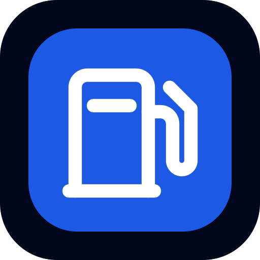
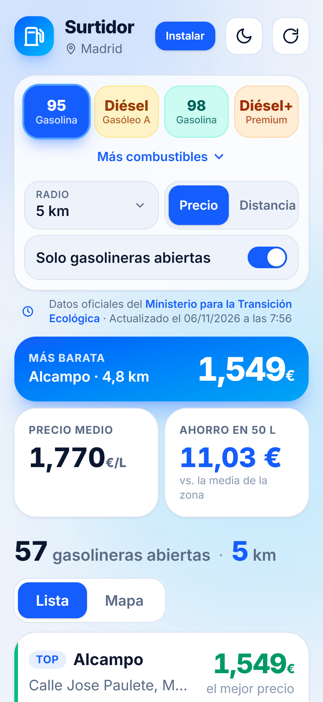
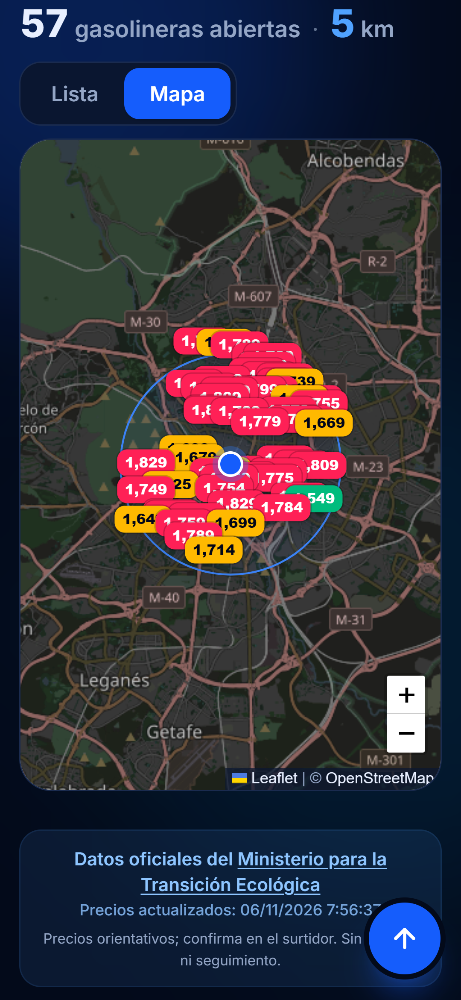

<div align="center">



# Surtidor

**Las gasolineras más baratas cerca de ti, con precios oficiales en tiempo real.**

PWA instalable · sin base de datos · sin cookies · lista para desplegar en Vercel

### [🚀 Pruébala en surtidor.vercel.app](https://surtidor.vercel.app/)


<br />


&nbsp;&nbsp;


</div>

---

## ¿Qué es?

Surtidor usa la ubicación de tu móvil y te muestra las gasolineras que tienes alrededor, ordenadas por precio o por distancia. Los datos salen directamente del servicio público del **Ministerio para la Transición Ecológica y el Reto Demográfico**, que publica los precios de todas las estaciones de servicio de España y los actualiza cada media hora aproximadamente.

## Funcionalidades

- 📍 **Geolocalización** al abrir la app. Si no das permiso, puedes buscar por localidad o código postal.
- 📏 **Radio de búsqueda** configurable: 5, 10, 15, 20, 30 o 50 km.
- ⛽ **8 combustibles**: Gasolina 95, Diésel, Gasolina 98 y Diésel+ a la vista; E10, GLP, GNC y AdBlue bajo «Más combustibles».
- 🕒 **Solo gasolineras abiertas**: interpreta el horario oficial de cada estación (`L-V: 06:00-22:00; S: 08:00-14:00`, `L-D: 24H`, turnos partidos, horarios que pasan la medianoche…).
- 💶 **Resumen de la zona**: la más barata, el precio medio y cuánto ahorras llenando 50 L frente a la media.
- 🎨 **Precios por colores**: verde, ámbar o rojo según lo barata o cara que sea cada gasolinera respecto a las de alrededor.
- 🗺️ **Mapa** con el precio sobre cada gasolinera y el círculo del radio de búsqueda.
- 🧭 **Cómo llegar** con un toque (abre la navegación en Google Maps).
- 🌗 **Tema claro y oscuro**: sigue al sistema y recuerda tu elección.
- 📲 **PWA completa**: instalable, funciona sin conexión con los últimos precios consultados, pantallas de inicio para iOS y accesos directos desde el icono.
- 🔒 **Sin cookies ni seguimiento**: no hay analítica; las preferencias se guardan solo en el navegador del usuario.

## Cómo funciona

```
┌──────────────┐   /api/estaciones?lat&lon&radio   ┌─────────────────────┐   ~12 MB JSON   ┌──────────────┐
│   Navegador  │ ───────────────────────────────▶  │  Función de Vercel  │ ─────────────▶  │  Ministerio  │
│   (la PWA)   │ ◀───────────────────────────────  │  caché en memoria   │ ◀─────────────  │  (API REST)  │
└──────────────┘     ~20 KB solo con tu radio      └─────────────────────┘                 └──────────────┘
```

- **Sin base de datos.** La función serverless (`api/estaciones.js`) descarga el listado completo del Ministerio (unas 11.500 estaciones, ~12 MB), lo compacta y lo **guarda en memoria 15 minutos**. A cada usuario le devuelve solo las estaciones de su radio (~20 KB).
- **Caché en la CDN.** Las respuestas llevan `s-maxage`, así que las consultas de usuarios cercanos se sirven desde la CDN de Vercel sin tocar la función.
- **Plan B.** Si la API no está disponible (por ejemplo, si sirves `dist/` como sitio estático), la app consulta directamente al Ministerio, que permite peticiones desde el navegador (CORS), y filtra en el cliente.
- **Sin conexión.** El service worker guarda la app y la última consulta de precios.

## Stack

| | |
|---|---|
| Interfaz | HTML + JavaScript sin framework |
| Estilos | [Tailwind CSS v4](https://tailwindcss.com/) |
| Build | [Vite](https://vite.dev/) |
| Mapa | [Leaflet](https://leafletjs.com/) + teselas de [OpenStreetMap](https://www.openstreetmap.org/) |
| Tipografía | [Inter](https://rsms.me/inter/) incluida en el proyecto con [Fontsource](https://fontsource.org/) (sin Google Fonts) |
| Backend | Una función serverless de [Vercel](https://vercel.com/) (Node.js) |
| Iconos y splash | Generados con [sharp](https://sharp.pixelplumbing.com/) a partir de un único SVG |

## Puesta en marcha

Requisitos: **Node.js 20** o superior.

```bash
git clone <url-del-repositorio> surtidor
cd surtidor
npm install
npm run dev
```

Abre `http://localhost:5173`. El servidor de desarrollo ya sirve `/api/estaciones` con el mismo código que se ejecuta en Vercel.

> La geolocalización del navegador solo funciona en `localhost` o con HTTPS.

### Scripts

| Comando | Qué hace |
|---|---|
| `npm run dev` | Servidor de desarrollo con la API incluida |
| `npm run build` | Compila la app en `dist/` |
| `npm run preview` | Sirve la versión de producción (con service worker) para probarla |
| `npm run icons` | Regenera iconos y pantallas de inicio de iOS a partir de `public/icon.svg` |

## Despliegue en Vercel

1. Sube el repositorio a GitHub, GitLab o Bitbucket.
2. En Vercel, **Add New → Project** e importa el repositorio.
3. Despliega. No hace falta configurar nada ni definir variables de entorno.

`vercel.json` ya indica el build de Vite, la región de la función (`cdg1`, París, cerca de España) y las cabeceras del service worker y del manifest.

## Estructura

```
├── api/
│   └── estaciones.js        # Función serverless de Vercel
├── lib/
│   └── estaciones.js        # Descarga, compactado, caché y filtrado por distancia (compartido)
├── src/
│   ├── main.js              # Interfaz, geolocalización, mapa y estado
│   ├── horario.js           # Intérprete de horarios («¿está abierta ahora?»)
│   └── style.css            # Tailwind + temas claro/oscuro
├── public/
│   ├── manifest.webmanifest # Manifest de la PWA
│   ├── sw.js                # Service worker (offline)
│   ├── icon.svg             # Icono fuente
│   ├── icons/               # Iconos PNG generados
│   ├── splash/              # Pantallas de inicio de iOS generadas
│   └── screenshots/         # Capturas para el diálogo de instalación
├── scripts/
│   └── icons.mjs            # Generador de iconos y splash
├── index.html
├── vite.config.js
└── vercel.json
```

## API

`GET /api/estaciones?lat=40.416&lon=-3.703&radio=5`

| Parámetro | Descripción |
|---|---|
| `lat`, `lon` | Coordenadas del usuario (obligatorios) |
| `radio` | Radio en km, de 1 a 100 (por defecto 5) |

```json
{
  "fecha": "06/11/2026 7:56:12",
  "total": 91,
  "estaciones": [
    {
      "id": "4508",
      "n": "BLANCA",
      "d": "GLORIETA EMBAJADORES, 0",
      "l": "Madrid",
      "p": "MADRID",
      "cp": "28012",
      "h": "L-V: 07:30-22:00; S: 08:00-22:00; D: 09:00-21:00",
      "lat": 40.405278,
      "lon": -3.703139,
      "pr": { "g95": 1.699, "diesel": 1.869, "dieselPlus": 1.869 },
      "km": 1.19
    }
  ]
}
```

Claves de `pr`: `g95`, `g95e10`, `g98`, `diesel`, `dieselPlus`, `glp`, `gnc`, `adblue` (€/L).

## Privacidad

- **No usa cookies** ni herramientas de analítica o seguimiento.
- El tema y los filtros elegidos se guardan en el `localStorage` del navegador y nunca salen del dispositivo.
- La ubicación solo se usa para pedir las gasolineras cercanas y no se guarda en ningún servidor.
- Servicios de terceros que usa la app: **OpenStreetMap** (teselas del mapa) y **Nominatim** (nombre de la zona y búsqueda de localidades).

## Fuente de los datos

Precios y estaciones: [Geoportal de Gasolineras](https://geoportalgasolineras.es/) del Ministerio para la Transición Ecológica y el Reto Demográfico, a través de su [servicio REST público](https://sedeaplicaciones.minetur.gob.es/ServiciosRESTCarburantes/PreciosCarburantes/EstacionesTerrestres/).

Los precios son orientativos y dependen de lo que comunique cada estación; confírmalos siempre en el surtidor.

Cartografía © [colaboradores de OpenStreetMap](https://www.openstreetmap.org/copyright).

## Licencia

Código publicado bajo la [licencia MIT](LICENSE): puedes usarlo, modificarlo y redistribuirlo libremente, también con fines comerciales, manteniendo el aviso de copyright.

Los datos de precios pertenecen a su fuente oficial y la cartografía a OpenStreetMap; cada uno se rige por sus propias condiciones.
